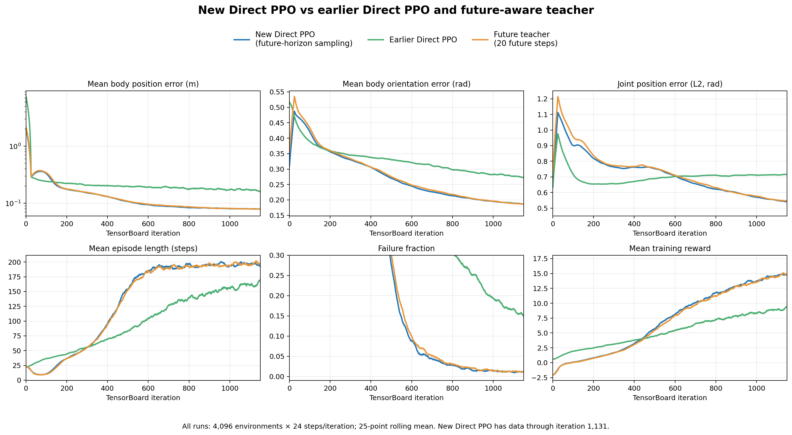
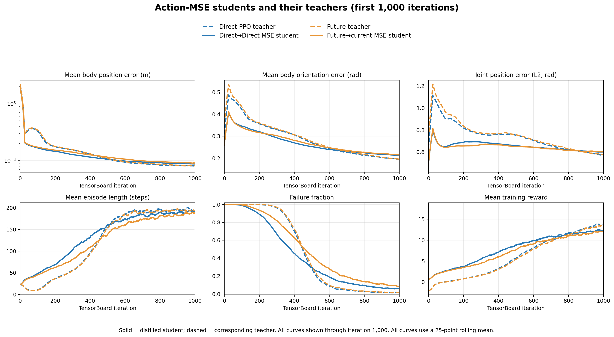
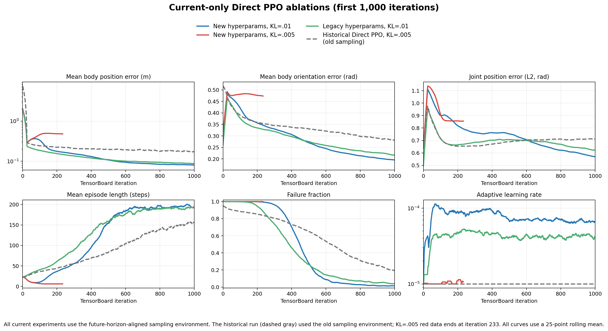

# G1 Humanoid Distillation Experiments

This repository is a reproducible snapshot of the HW6 G1 tracking/distillation experiments.  It contains the experiment code, TensorBoard comparison figures, and three selected teacher checkpoints.

## Main findings

- Giving the teacher 20 future reference frames did not produce a visible in-distribution tracking advantage over the aligned current-reference Direct PPO baseline during the first 1,000 iterations.
- The Direct-to-Direct and Future-to-current Action-MSE students use the same student recipe; their comparison isolates the teacher's future-reference input.  The future teacher did not show a clear student-side advantage in this window.
- PPO's `desired_kl` is an adaptive learning-rate target, not the teacher-student KL loss.  With the lower target (`0.005`), the scheduler reduced the learning rate much more aggressively than with `0.01`.

## Figures

### Teacher PPO comparison



### Action-MSE students and their teachers



### Current-only PPO / adaptive-KL ablations



## Checkpoints

All `.pt` files are below GitHub's 100 MB per-file limit and are tracked directly.

| File | Provenance |
| --- | --- |
| `models/original_future_teacher/model_latest.pt` | Original supplied future-reference teacher checkpoint. |
| `models/retrained_future_teacher/model_1000.pt` | Our retrained 20-future-frame teacher at iteration 1,000. |
| `models/retrained_direct_ppo_teacher/model_1000.pt` | Our aligned current-only Direct PPO teacher at iteration 1,000. |

The two retrained checkpoints are deliberately frozen at the 1,000-iteration comparison point used in the figures.

## Scope and caveats

- The actor never receives future frames in the Direct PPO/current-only experiments.  The future teacher uses its future-motion CNN only in the teacher branch.
- The historical old Direct PPO run used an earlier sampling setup.  Therefore the four `desired_kl` curves are useful diagnostics, but not a perfectly matched 2x2 factorial study.
- `desired_kl` controls PPO's old-vs-new-policy KL feedback loop; it is distinct from the explicit teacher-student KL-matching objective.

## Layout

- `src/`, `tests/`, `pyproject.toml`, `uv.lock`: code snapshot used for the experiments.
- `figures/`: the three comparison plots above.
- `models/`: selected teacher artifacts only; no rollout logs or student checkpoints.

## Setup

```bash
uv sync
uv run pytest -q tests/test_baseline.py
```
